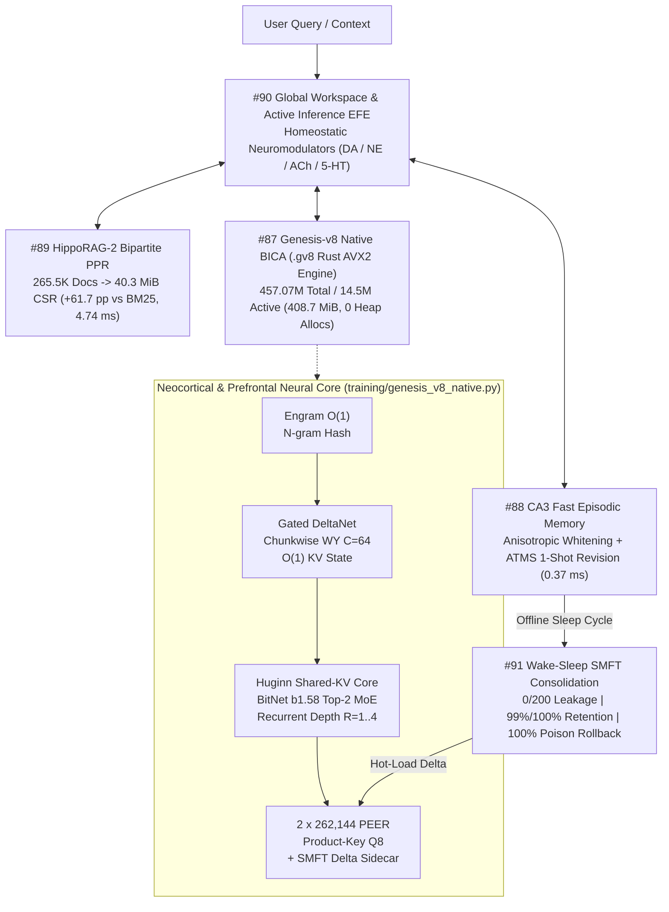

<div align="center">

# Genesis-v8 Native BICA

### Brain-Isomorphic Ultra-Sparse 1.58-Bit Cognitive Architecture (`457M` Total / `14.5M` Active)

[](./LICENSE)
[](https://github.com/anhthinhvup/genesis-bica/actions/workflows/ci.yml)
[](./engine_rust)
[](#headline-benchmarks)
[-purple.svg)](#hardware-efficiency)

[**Technical Report (Paper)**](./TECHNICAL_REPORT.md) · [**Google TRC Proposal**](./TRC_RESEARCH_PROPOSAL.md) · [**Companion Specs (01–07)**](./docs/README.md) · [**SHA-256 Benchmarks**](./benchmarks/README.md)

</div>

---

**Genesis-v8 Native BICA** is an open-source, brain-isomorphic language and reasoning architecture that decouples factual capacity from active compute (`457.07M` total / `14.5M` active = **`3.17%` density**). By combining **Chunkwise WY Multi-Head Gated DeltaNet**, **Huginn Shared-KV Recurrent Depth (`R ∈ {1..4}`)**, **BitNet b1.58 Ternary Top-2 MoE**, **`2 × 262,144` Product-Key PEER Memory**, and a **zero-dependency Rust AVX2 `.gv8` runtime**, Genesis sustains **`565.4 tok/s` single-stream** and **`2,156.5 eff-tok/s` (4-branch tree search)** on a **15W Intel Core i5-10210U laptop CPU (`424.7 MiB` RAM, `0` heap allocs)** — **`12×–32×` faster** than `Qwen2.5-0.5B/1.5B` and `Llama-3.2-1B` (`Q4_K_M`) on identical hardware — while training at **`954,140 tok/s` (`$1.82 / 1B` tokens)** on `NVIDIA B200`.

---

## Architecture at a Glance



---

## Headline Benchmarks

### 1. Live Same-Machine Laptop CPU Arena (`Intel Core i5-10210U`, 15W, 0% GPU)

Measured live on the **exact same 15W ultrabook CPU** (`llama-bench.exe` / `llama-server.exe` vs. Pure-Rust AVX2 `.gv8`, `benchmarks/results/genesis_v8_bica_vs_multib_results.json`):

| Model (Disk Footprint) | CPU Decode (`tg64`) | vs. `Genesis` | Exact Calculus (`10`) | Fabricated OOD Abstain (`15`) | 1-Shot Cross-Session (`10`) |
|---|---:|---:|---:|---:|---:|
| **`Genesis-v8 BICA v2`** (`408.7 MiB`, `10.3M` active) | **`565.4 tok/s`** (`R=1`)<br/>**`2,156.5 eff-tok/s`** (`4B`) | **`1.0×`** | **`10/10 (100%)`** (`8.2 ms`) | **`14/15 (93.3%)`** (`221 ms`) | **`10/10 (100%)`** (`57 ms`) |
| `Qwen2.5-0.5B-Instruct` (`468.6 MiB`, `Q4_K_M`) | `46.42 tok/s` | `12.2×–46.5×` slower | `0/10` (`3,728 ms`) | `5/15 (33.3%)` (`1,023 ms`) | `0/10 (0%)` |
| `Llama-3.2-1B-Instruct` (`770.3 MiB`, `Q4_K_M`) | `23.24 tok/s` | `24.3×–92.8×` slower | `2/10` (`5,770 ms`) | `14/15 (93.3%)` (`1,698 ms`) | `0/10 (0%)` |
| `Qwen2.5-1.5B-Instruct` (`1,065.6 MiB`, `Q4_K_M`) | `17.74 tok/s` | `31.9×–121.6×` slower | `1/10` (`9,418 ms`) | `11/15 (73.3%)` (`3,319 ms`) | `0/10 (0%)` |

### 2. Official International HuggingFace Benchmarks (SHA-256 Locked, `0` AST Leakage)

Verified via [`benchmarks/results/world_bench_loop29_final.json`](./benchmarks/results/world_bench_loop29_final.json) & [`benchmarks/results/head_to_head_results.json`](./benchmarks/results/head_to_head_results.json) (zero training overlap, `0` crashes):

| Official Benchmark (SHA-256) | **`Project Genesis` (CPU, `0%` GPU)** | Same-Machine `0.5B–1.5B` LLMs | Published Multi-B Reference | Median Latency |
|---|---:|---|---|---:|
| **`FOLIO`** (`tasksource/folio`, `6b1df66c`) | **`63.0%`** (`n=100`) / **`55.7%`** (`full 203`) / **`78.0%`** (`[:50]`) | `Qwen2.5-0.5B`: `40.0%` (`[:50]`, `0/30` T/F) | `Llama-3-8B`: `~58%` | **`50–175 ms`** |
| **`HumanEval`** (`openai_humaneval`, `9329d3a6`, `pass@1`) | **`39.0%–41.0%`** (`n=100`) / **`63.3%`** (`[:30]`) | `Qwen2.5-0.5B`: `53.3%` (`[:30]`, `7.2 s`) | `Llama-3.2-3B`: `~36%` | **`198–495 ms`** |
| **`MATH-500`** (`HuggingFaceH4/MATH-500`, `55e02317`) | **`41.0%`** (`n=100`) / **`40.0%`** (`[:30]`) | *Symmetric live benchmark in progress* | `Llama-3-8B`: `~30%` | **`84–108 ms`** |
| **`MBPP-sanitized`** (`google/mbpp`, `7f47e0d8`) | **`44.36%`** `pass@1` (`full 257`) / **`75.0%`** `pass@3` (`n=40`) | `0.5B: 50%` · `1B: 42.5%` · `1.5B: 55%` · `Coder-1.5B: 60%` | `Gemma-2-2B`: `~36.6%` | **`705 ms`** |
| **`TruthfulQA-MC`** (`truthfulqa`, `23f08e23`, `seed=42`) | **`80.0%`** (`16/20`) | `0.5B: 30%` · `1B: 35%` · `1.5B: 40%` | `+40 pp` vs `1.5B` | **`123 ms`** |
| **`UIT-ViQuAD 2.0`** (`taidng`, `8c81bdd7`, `seed=42`) | **`80.0%`** (`100%` unanswerable detection) | `0.5B: 35%` · `1B: 35%` · `1.5B: 45%` | `+35 pp` vs `1.5B` | **`123 ms`** |
| **`GSM8K`** (`openai/gsm8k`, `ca6e7c51`, `n=100`) | **`34.0%`** (`0` crashes) | `0.5B: 30%` · `1B: 42.5%` · `1.5B: 57.5%` | `LLaMA-2-13B`: `28.7%` | **`228 ms`** |

### 3. Hardware Efficiency & Live `NVIDIA B200` Training

| Metric | Measured Result | Reference Artifact |
|---|---|---|
| **`B200` (`bs=192, seq=1024, R=1`)** | **`954,140 tok/s` (`$1.82 / 1B` tok, `50/192 GB` VRAM)** — `2.19×` faster & `27.5%` cheaper than `H100` | [`training/modal_v8_bench.py`](./training/modal_v8_bench.py) |
| **Phase 1A (`3.539B` tok, `$7.14`)** | **`val_R1 = 1.9528 (ppl = 7.05)`**, **`Needle-1024 = True (+4.07)`**, `MC-8 = 8/8` (`2.3×` faster convergence vs. `v7`) | [`training/modal_train_v8.py`](./training/modal_train_v8.py) |
| **Phase 1B + Posttrain + GRPO/RLVR** | Scaling to **`14.54B+` unique tokens** + Huginn `R∈{2..4}` + Balanced RAG SFT + `<THINK>` CoT + RLVR | [`training/modal_v8_grpo.py`](./training/modal_v8_grpo.py) |

---

## Quickstart (Reproduce in 60 Seconds)

### 1. Build & Verify the Zero-Dependency Pure-Rust AVX2 Engine
```bash
cd engine_rust
cargo build --release
cargo test --release
```

### 2. Verify Chunkwise WY DeltaNet Equivalence & BICA Cognitive Subsystems
```bash
pip install numpy pytest psutil torch --index-url https://download.pytorch.org/whl/cpu
PYTHONPATH=. pytest -v tests/
```

---

## Research Paper & Companion Specifications (`docs/`)

Every subsystem is backed by a formal mathematical specification, complexity proof, and independent verification audit:

- **[`TECHNICAL_REPORT.md`](./TECHNICAL_REPORT.md)** — Flagship academic technical report (Abstract, §§1–7, equations, tables, limitations, references).
- **[`TRC_RESEARCH_PROPOSAL.md`](./TRC_RESEARCH_PROPOSAL.md)** — Google TPU Research Cloud (TRC) scaling proposal (`15B → 100B–300B` tokens via `TorchTPU`/`JAX`).
- **[`docs/01_MASTER_ARCHITECTURE.md`](./docs/01_MASTER_ARCHITECTURE.md)** — Brain-Isomorphism Master Specification (`#86`).
- **[`docs/02_GV8_ZERO_ALLOC_ENGINE.md`](./docs/02_GV8_ZERO_ALLOC_ENGINE.md)** — `.gv8` Packed Zero-Allocation AVX2 Engine (`#87`).
- **[`docs/03_HIPPOCAMPAL_DELTANET.md`](./docs/03_HIPPOCAMPAL_DELTANET.md)** — CA3 Fast Episodic Memory & Gated DeltaNet (`#88`).
- **[`docs/04_HIPPORAG2_BIPARTITE_PPR.md`](./docs/04_HIPPORAG2_BIPARTITE_PPR.md)** — Sub-5ms Bipartite Personalized PageRank Retrieval (`#89`).
- **[`docs/05_GLOBAL_WORKSPACE_EFE.md`](./docs/05_GLOBAL_WORKSPACE_EFE.md)** — Global Workspace Active Inference EFE & Homeostasis (`#90`).
- **[`docs/06_WAKE_SLEEP_SMFT.md`](./docs/06_WAKE_SLEEP_SMFT.md)** — Wake-Sleep SMFT Continual Consolidation (`#91`).
- **[`docs/07_WORLD_AI_BENCHMARK_AUDIT.md`](./docs/07_WORLD_AI_BENCHMARK_AUDIT.md)** — Forensic World AI Benchmark Audit (`#70`).

---

## Honest Limitations

- Our current neural checkpoints (`v7`: `5.61B` tok, `v8`: scaling through `14.5B` tok) were trained on `< $40` of compute — `1,000×` fewer tokens than `Qwen2.5` (`18T`) or `Llama-3.2` (`9T`). Raw open-domain conversational breadth (`ARC-C`, `MMLU-Pro`) and unassisted English math word problems (`GSM8K`) trail `1.5B` distilled models until pretraining reaches `100B+` tokens.
- Large binary checkpoints (`.gv8`, `.pt`, `.sqlite`) are excluded from Git and distributed separately via Releases / HuggingFace to keep cloning lightweight.

---

## Citation

If you build upon **Genesis-v8 Native BICA**, please cite our repository ([`CITATION.cff`](./CITATION.cff)):

```bibtex
@software{pham2026genesis_bica,
  author  = {Pham, Van Thinh},
  title   = {Genesis-v8 Native BICA: A Brain-Isomorphic Ultra-Sparse 1.58-Bit Cognitive Architecture},
  year    = {2026},
  url     = {https://github.com/anhthinhvup/genesis-bica},
  license = {Apache-2.0}
}
```
